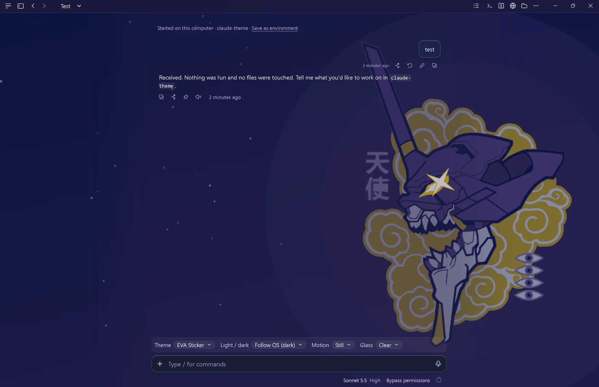
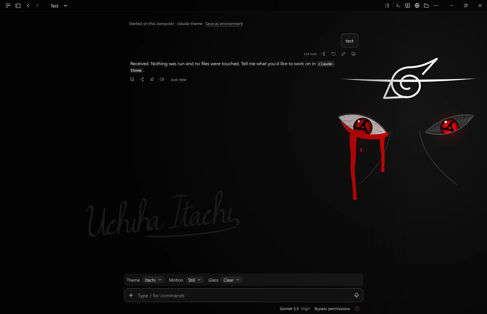
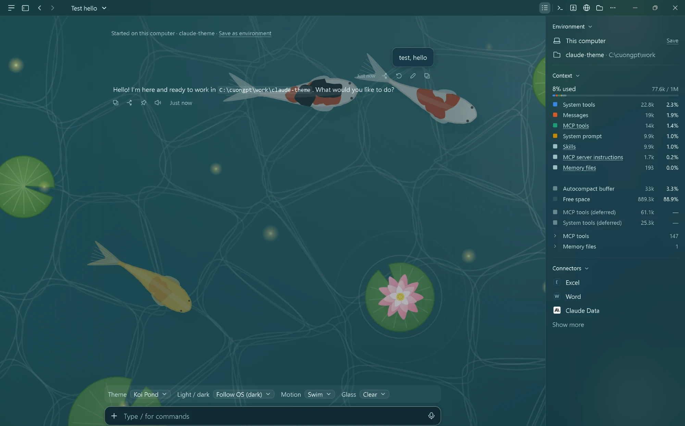

# Looksmith

**English** · [Tiếng Việt](README_VI.md)

Themes for Claude desktop: pick one right above the input, light and dark follow your OS, with optional motion and clear glass.



<details>
<summary>All screenshots</summary>

**EVA Sticker**



**Itachi**



**Koi Pond**



</details>

## Themes

| Theme | Light | Dark |
| --- | --- | --- |
| **EVA Sticker**: flat five-colour sticker, a purple mecha head, yellow clouds, the word 天使; four eyes blink |  |  |
| **Itachi**: two red Sharingan eyes under the leaf headband, one weeping blood; the eyes turn from one tomoe to three, then to the Mangekyo, and the blood drips | dark only: no light/dark switch |  |
| **Koi Pond**: a koi pond with lily pads and lotus flowers; three koi swim |  |  |

## Install

The commands below need **Claude Code on the command line** (the `claude` command), which Claude desktop does not include. If you don't have it, install it one of two ways, then open a new terminal and check with `claude --version`:
- **npm** (needs Node.js 22 or later): `npm install -g @anthropic-ai/claude-code@latest`
- **Official installer**: macOS `curl -fsSL https://claude.ai/install.sh | bash`, Windows PowerShell `irm https://claude.ai/install.ps1 | iex`

Then run this in a terminal (Windows: PowerShell or cmd; macOS: Terminal), not the Claude chat box, then restart Claude:

```
claude plugin install looksmith --marketplace cuongphamthe185/looksmith
```

Rather not install the `claude` command? Type `/plugin` in the Claude desktop chat box, add the marketplace `cuongphamthe185/looksmith`, then install **looksmith**.

**Update** (then restart Claude):

```
claude plugin marketplace update looksmith
claude plugin update looksmith
```

For automatic updates: `/plugin` → **Marketplaces** → **looksmith** → **Enable auto-update**.

**Uninstall** (then restart Claude; the theme goes away):

```
claude plugin uninstall looksmith
claude plugin marketplace remove looksmith
```

To remove every trace, also delete the saved choice: `~/.claude/plugins/store/looksmith_looksmith-*.json`.

## Requirements

- **Windows:** turn on two settings in Settings → Accessibility → Visual effects. Windows 11 has both on by default.
  - **Animation effects**, for the swimming koi. If they still stand still, run `SystemPropertiesPerformance.exe` and tick **Animate controls and elements inside windows**.
  - **Transparency effects**, for clear glass.
- **macOS:** the full effects work by default. If you turned on *Reduce motion* or *Reduce transparency* (System Settings → Accessibility), turn it off. Not yet tested on a Mac.

When a setting is missing, the bar says so and offers a button that opens it.

## Use

The bar above the input:
- **Theme**: a theme, or *Off* for the app default.
- **Light / dark**: follow the OS, always light or always dark (hidden for Itachi, which is dark only).
- **Motion**: *Still* or *Animated*.
- **Glass**: *Off* or *Clear* (see-through chat).

The choice applies to every open session. `/themes` opens the same choices in a pane.

**No bar?** The theme and the bar are drawn by the plugin, and the plugin runs only inside an active chat session. This is a Claude desktop limit: with no session, the plugin cannot run or show anything.
- **Just installed, no session yet:** open the Code tab, start a new session and send any message (for example "hi"). The bar appears above the input, and the theme you pick applies to the sessions you open after.
- **A session you have not used for a while:** Claude desktop runs only a few sessions at a time. Wait a few seconds with it open, or send any message in it.

## Notes

- *Animated* on Koi Pond is heavy: about 16% CPU and 40–45% GPU on an i7-1065G7 laptop (*Still* takes about 3%). On a slow machine, use *Still*.
- The scene shows only behind the conversation column; the sidebars only change colour.
- The terminal and editor extensions draw no themes.

## License

MIT, see [LICENSE](LICENSE).
