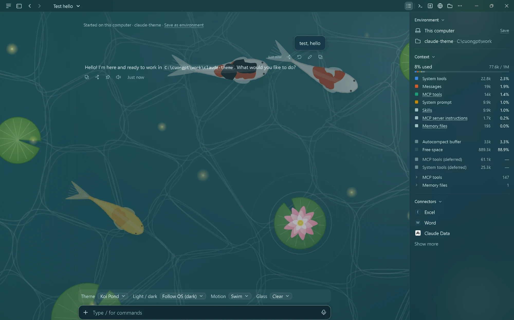

# Looksmith

[Tiếng Việt](README.md) · **English**

Themes for Claude desktop: pick one right above the input, light and dark follow your OS, with optional motion and clear glass.



## Themes

| Theme | Light | Dark |
| --- | --- | --- |
| **Koi Pond**: a koi pond with lily pads and lotus flowers; three koi swim |  |  |

## Install

Run this in PowerShell, Terminal or cmd (not the Claude chat box), then restart Claude:

```
claude plugin install looksmith --marketplace cuongphamthe185/looksmith
```

**Update** (then restart Claude):

```
claude plugin marketplace update looksmith
claude plugin update looksmith
```

For automatic updates: `/plugin` → **Marketplaces** → **looksmith** → **Enable auto-update**.

## Requirements

- **Windows:** turn on two settings in Settings → Accessibility → Visual effects. Windows 11 has both on by default.
  - **Animation effects**, for the swimming koi. If they still stand still, run `SystemPropertiesPerformance.exe` and tick **Animate controls and elements inside windows**.
  - **Transparency effects**, for clear glass.
- **macOS:** the full effects work by default. If you turned on *Reduce motion* or *Reduce transparency* (System Settings → Accessibility), turn it off. Not yet tested on a Mac.

When a setting is missing, the bar says so and offers a button that opens it.

## Use

The bar above the input:
- **Theme**: a theme, or *Off* for the app default.
- **Light / dark**: follow the OS, always light or always dark.
- **Motion**: *Still* or *Swim*.
- **Glass**: *Off* or *Clear* (see-through chat).

The choice applies to every open session. `/themes` opens the same choices in a pane.

**No bar?** Claude desktop runs only a few sessions at a time, so one you have not used for a while has no plugin running yet. Wait a few seconds with it open, or send any message in it.

## Notes

- *Swim* is heavy: about 16% CPU and 40–45% GPU on an i7-1065G7 laptop (*Still* takes about 3%). On a slow machine, use *Still*.
- The scene shows only behind the conversation column; the sidebars only change colour.
- The terminal and editor extensions draw no themes.

## Add a theme

Put two SVG scenes (light, dark) in `themes/<id>/`, optionally two animated ones, and declare the theme in `hooks/themes.ts`. Each scene needs a `viewBox`, `preserveAspectRatio="xMidYMid slice"`, at most 131,072 characters, and no scripts.

## License

MIT, see [LICENSE](LICENSE).
