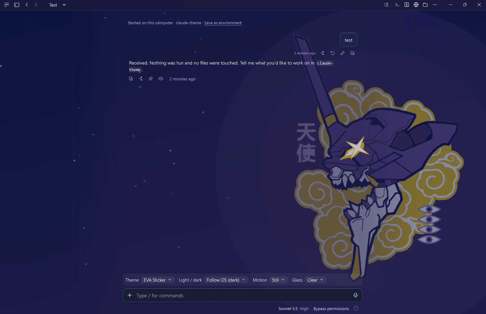
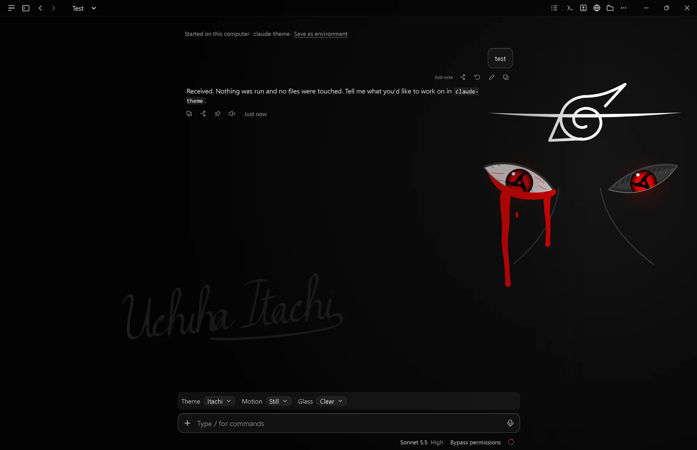
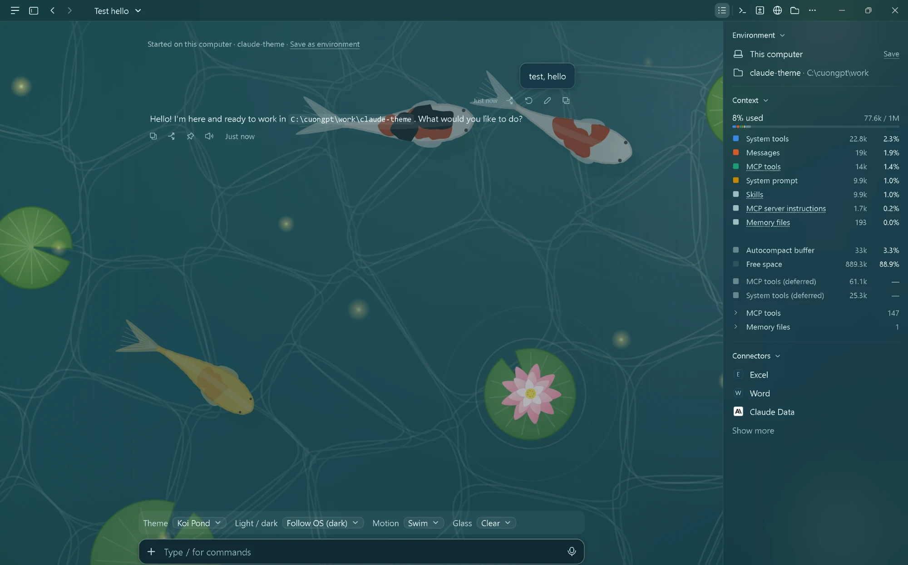

# Looksmith

[English](README.md) · **Tiếng Việt**

Bộ theme cho Claude desktop: chọn theme ngay trên ô nhập, sáng/tối theo hệ điều hành, có chuyển động và kính trong.



<details>
<summary>Xem tất cả ảnh chụp</summary>

**EVA Sticker**



**Itachi**



**Koi Pond**



</details>

## Theme

| Theme | Sáng | Tối |
| --- | --- | --- |
| **EVA Sticker**: sticker phẳng 5 màu, đầu mecha tím, mây vàng, chữ 天使; 4 mắt chớp |  |  |
| **Itachi**: hai mắt Sharingan đỏ dưới băng trán làng Lá, một mắt chảy máu; mắt chuyển từ 1 tomoe lên 3, rồi thành Mangekyo, máu nhỏ giọt | chỉ có nền tối: không đổi sáng/tối |  |
| **Koi Pond**: ao koi, lá sen, hoa sen; 3 con koi bơi |  |  |

## Cài đặt

Các lệnh bên dưới cần **Claude Code bản dòng lệnh** (lệnh `claude`). Claude desktop không kèm lệnh này. Nếu chưa có, cài theo một trong hai cách, rồi mở terminal mới và kiểm tra bằng `claude --version`:
- **npm** (cần Node.js 22 trở lên): `npm install -g @anthropic-ai/claude-code@latest`
- **Bộ cài chính thức**: macOS `curl -fsSL https://claude.ai/install.sh | bash`, Windows PowerShell `irm https://claude.ai/install.ps1 | iex`

Sau đó chạy trong terminal (Windows: PowerShell hoặc cmd; macOS: Terminal), không phải ô chat của Claude, rồi khởi động lại Claude:

```
claude plugin install looksmith --marketplace cuongphamthe185/looksmith
```

Không muốn cài lệnh `claude`: gõ `/plugin` trong ô chat của Claude desktop, thêm marketplace `cuongphamthe185/looksmith`, rồi cài **looksmith**.

**Cập nhật** (rồi khởi động lại Claude):

```
claude plugin marketplace update looksmith
claude plugin update looksmith
```

Muốn tự cập nhật: `/plugin` → **Marketplaces** → **looksmith** → **Enable auto-update**.

**Gỡ cài đặt** (rồi khởi động lại Claude, theme biến mất):

```
claude plugin uninstall looksmith
claude plugin marketplace remove looksmith
```

Muốn xoá sạch, xoá thêm file lựa chọn đã lưu: `~/.claude/plugins/store/looksmith_looksmith-*.json`.

## Yêu cầu

- **Windows:** bật 2 mục ở Settings → Accessibility → Visual effects. Windows 11 mặc định bật sẵn.
  - **Animation effects**: để cá bơi. Nếu đã bật mà cá vẫn đứng yên: chạy `SystemPropertiesPerformance.exe` và tick **Animate controls and elements inside windows**.
  - **Transparency effects**: để có kính trong.
- **macOS:** mặc định đã dùng được đủ hiệu ứng. Nếu bạn từng bật *Reduce motion* hoặc *Reduce transparency* (System Settings → Accessibility) thì tắt đi. Chưa thử trên Mac.

Khi thiếu một mục, hàng chọn sẽ báo và có nút mở đúng cài đặt.

## Cách dùng

Hàng chọn trên ô nhập:
- **Theme**: chọn theme, hoặc *Off* để về giao diện gốc.
- **Light / dark**: theo hệ điều hành, luôn sáng hoặc luôn tối (ẩn với Itachi, theme chỉ có nền tối).
- **Motion**: *Still* (tĩnh) hoặc *Animated* (chuyển động).
- **Glass**: *Off* hoặc *Clear* (khung chat trong suốt).

Lựa chọn áp cho mọi phiên đang mở. Gõ `/themes` để mở các lựa chọn trong khung riêng.

**Không thấy hàng chọn?** Theme và hàng chọn do plugin vẽ, mà plugin chỉ chạy bên trong một phiên chat đang hoạt động. Đây là giới hạn của Claude desktop: chưa có phiên thì plugin không chạy được và không hiện gì.
- **Mới cài, chưa có phiên nào:** mở tab Code, tạo phiên mới và gửi một tin nhắn bất kỳ (ví dụ "hi"). Hàng chọn sẽ hiện trên ô nhập, và theme đã chọn sẽ áp cho các phiên mở sau.
- **Phiên lâu không dùng:** Claude desktop chỉ chạy một số phiên cùng lúc. Chờ vài giây khi mở phiên đó, hoặc gửi một tin nhắn bất kỳ.

## Lưu ý

- *Animated* với Koi Pond tốn tài nguyên: khoảng 16% CPU và 40–45% GPU trên laptop i7-1065G7 (*Still* chỉ khoảng 3%). Máy yếu nên dùng *Still*.
- Tranh chỉ hiện sau cột hội thoại; thanh bên chỉ đổi màu.
- Bản terminal và tiện ích trong trình soạn thảo không hiện theme.

## Giấy phép

MIT, xem [LICENSE](LICENSE).
